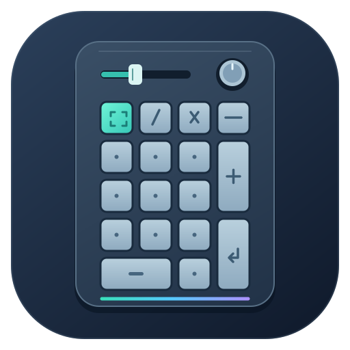
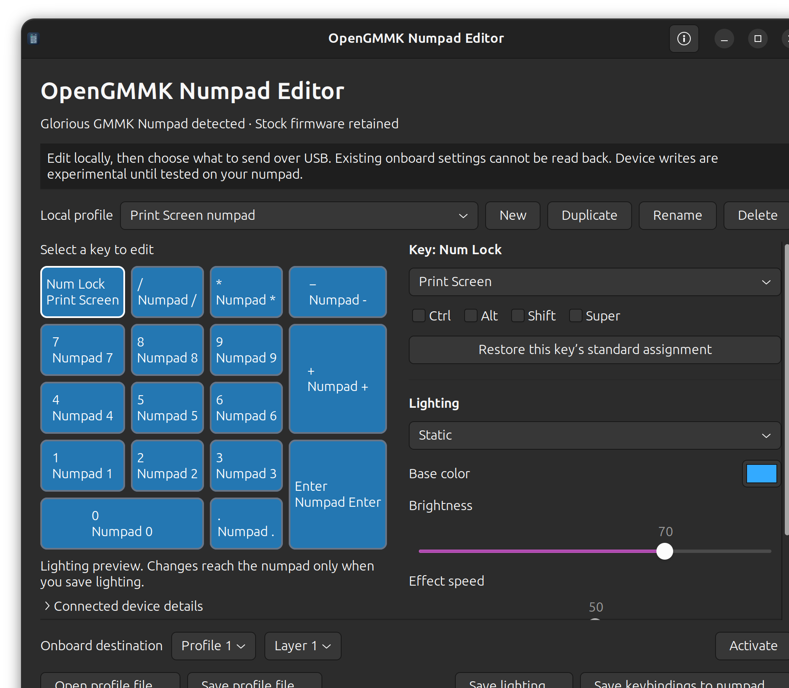

# OpenGMMK Numpad Editor



A native Linux app for editing **Glorious GMMK Numpad keybindings, onboard profiles, and RGB while keeping the stock firmware**. No Windows application or replacement firmware is required.

This is an independent community project, unaffiliated with Glorious.



## Features

- Edit all 17 numpad keys, including Print Screen and Ctrl, Shift, Alt, or Super combinations.
- Save to any of three onboard profile slots and three layers per slot, or activate a slot/layer.
- Choose Static, Breathing, Rainbow, Wave #1, Ripple Graff, or Off, with color, brightness, and speed controls.
- Add static colors to individual keys over the global lighting effect.
- Keep up to 32 named local profiles in a portable JSON file; duplicate, rename, open, and save them.
- Read battery and firmware information over USB.
- Keep a top-bar indicator for USB/Bluetooth connection status and battery percentage while the app runs.
- Launch from the desktop application menu with its own name and icon.

**Support:** stock USB device `320f:5088`, revision `0088`, configuration interface `02`, with the exact HID descriptor documented in [PROTOCOL.md](PROTOCOL.md). Other models and revisions are deliberately rejected for configuration. Bluetooth monitoring reads Ubuntu's existing device and battery information; configuration still requires USB.

The application has been reported to work well in daily use by its initial user. The automated checks and protocol review are documented in [VALIDATION.md](VALIDATION.md). Unplug/replug persistence, use on another computer, and every combination of hardware settings have not yet been independently verified.

## Install

Requires Linux, Python 3.10 or newer, and GTK 3.24. On Ubuntu, install the desktop dependencies if they are missing:

```sh
sudo apt install python3 python3-gi gir1.2-gtk-3.0
```

Download or clone the project, open its folder in a terminal, then install for your desktop user:

```sh
sh install.sh
```

Launch **OpenGMMK Numpad Editor** from Ubuntu's application menu. To run directly from the project folder:

```sh
sh run.sh
```

No PyPI dependencies are needed. The editor has been checked on Ubuntu 26.04 with GNOME; other distributions and desktops need their own testing.

The top-bar icon uses the desktop's existing StatusNotifier/AppIndicator support. Ubuntu normally provides this through its Ubuntu AppIndicators extension. See [Top-bar troubleshooting](#top-bar-troubleshooting) if the icon does not appear.

### One-time USB access

Connect the numpad with its USB cable. If access is unavailable, click **Set up USB access…** in the app, or run:

```sh
sh install-device-access.sh
```

The setup uses Ubuntu's normal password prompt in a terminal to install a rule limited to this device's configuration interface. The editor does not receive the password. Reconnect the USB cable if needed, then click **Refresh device**. Run the app as your ordinary desktop user.

## Use

1. Create a local profile or open an existing profile JSON file.
2. Select a key to change its assignment or color; choose the global lighting effect and settings.
3. Use **Save profile file…** to keep a portable copy of your intended configuration.
4. Choose an onboard profile slot and layer. Use **Save keybindings to numpad…** or **Save lighting…**, and review the settings before confirming.
5. Check the physical keys and lighting. To test onboard persistence, disconnect and reconnect USB, activate the same slot/layer, and check it again. Testing on another computer without remapping software provides a further check.

The [Print Screen example](examples/Print-Screen.json) is a standard layout with the top-left key changed to Print Screen. Opening it only changes the local draft.

### Connection and battery indicator

The top-bar menu shows whether the numpad is connected over **USB**, **Bluetooth**, both, or neither, plus its battery percentage when available. Use **Open editor** to return to your draft, **Refresh status** to check again, or **Quit** to stop the app and its monitoring.

Closing the editor window keeps it running in the top bar when the desktop has accepted the indicator. Your current draft stays in memory; reopen the editor to continue. Use **Save profile file…** to preserve the draft across quitting or restarting. **Quit** asks about unsaved edits. If the desktop has no indicator support, closing the window follows the normal quit flow so the app does not become inaccessible.

Connection status refreshes about every five seconds. USB battery status refreshes about every 30 seconds using the same battery/firmware query as the manual button. Monitoring does not upload profiles, change RGB, or replace the separate slider helper. A failed refresh can show a previous reading as **last reading** for up to two minutes; an expired reading becomes unavailable. Switching devices or connection types clears the old reading.

USB connection means USB power is present; it does **not** establish that the battery is charging. The stock USB status field for charging is not documented, so the app does not guess its meaning. Bluetooth battery data comes from BlueZ's standard battery interface or a UPower entry that identifies the same device. If Ubuntu does not provide that data, the app shows **Battery unavailable**. It never pairs, connects, or probes the numpad over Bluetooth on your behalf.

The app does not start automatically at login. Launch it from the application menu when you want the indicator. Bluetooth monitoring and its battery display still need a physical test with the numpad connected over Bluetooth.

### Top-bar troubleshooting

First check that the editor is still running and that its window reports a connected device. On Ubuntu GNOME, open the Extensions app and check whether **Ubuntu AppIndicators** is installed and enabled. The indicator also works with desktops that provide a compatible StatusNotifier host.

Only if the Ubuntu extension is missing, install it through Ubuntu's package manager:

```sh
sudo apt install gnome-shell-extension-appindicator
```

Enable the extension and log out and back in if the desktop requests it. The editor does not install or enable shell extensions itself. Without a compatible host, the editor and its in-window status remain usable.

### Local files and onboard settings

**A local profile is a draft, not a download of the numpad's current configuration.** Saving a JSON file does not write to the numpad. The known status command reads battery and firmware information only; it cannot read or back up onboard keybindings, RGB, or other settings. Keep a local profile file for every configuration you want to restore.

The default profile folder is `~/Documents/GMMK Numpad Profiles`. Files use format version 2. Version 1 drafts open with explicit default settings added and are saved as version 2.

### What each save replaces

| Action | Behavior |
| --- | --- |
| Save keybindings | Replaces all 17 key assignments in the selected layer. It also restores the encoder's press action to the manufacturer's calculator assignment. |
| Save lighting | Replaces the selected layer's global effect and complete custom-color overlay, plus the explicit indicator, sensitivity, and Bluetooth brightness settings shown in the dialog. |
| Activate | Selects an onboard profile slot and layer without uploading the local draft. |

A lighting save clears custom colors for keys without an override and for the side LEDs, allowing the global effect to control them. Removing the last override also clears the onboard overlay. **Off** clears global lighting and the custom-color overlay; saved override colors remain in the local draft. The separate knob/key glow behavior is left untouched. The on-screen preview shows colors without animating effects.

The manufacturer's lighting settings frame additionally sets Win Lock to `0`, per-key enable to `1`, and the debounce/latency byte to `8`. These unknown onboard values cannot be read and preserved by the app. Initial indicator and sensitivity choices come from CORE's shipped application defaults: sensitivity `2`, Num Lock indicator off, and battery indicator on. They are not a measurement of the connected device or verified firmware factory defaults. See [PROTOCOL.md](PROTOCOL.md) for the exact settings.

### Slider, knob, and host shortcuts

The editor does not replace firmware or configure rotary turn mode, slider actions, macros, or the separate knob sound-control/glow command. An existing Ubuntu slider volume helper remains separate; each Ubuntu computer needs that helper if you want the same host volume integration. A lighting save can change its explicit sensitivity setting, so check slider and knob behavior afterward.

Host remapping software can hide whether an onboard key change succeeded. If testing a key also mapped by Input Remapper or another utility, temporarily disable only that numpad mapping. Desktop shortcuts still determine what the computer does with a key such as Print Screen.

## Remove

Keep profile backups outside the application folder, then run:

```sh
sh uninstall.sh
```

The installer uses `~/.local/share/gmmk-numpad-configurator` and the launcher `~/.local/share/applications/io.github.opengmmk.NumpadEditor.desktop`. Removal deletes only unchanged managed files and preserves added or modified files. Removing the app does not restore earlier onboard settings.

USB access is installed separately. To remove its rule:

```sh
sudo rm -- /etc/udev/rules.d/69-gmmk-numpad-configurator.rules
sudo udevadm control --reload-rules
```

Reconnect the numpad to refresh access. Keep any separately installed slider service and its access rule if you still use them.

## Development

Run the hardware-free test suite from the project folder:

```sh
python3 -B -m unittest discover -s tests -v
```

With GTK and a graphical session available, check UI construction with:

```sh
sh run.sh --smoke-test
```

See [DEVELOPMENT.md](DEVELOPMENT.md) for the project handoff and implementation guide, [CONTRIBUTING.md](CONTRIBUTING.md) for reporting hardware results, [PROTOCOL.md](PROTOCOL.md) for source evidence and packet details, and [VALIDATION.md](VALIDATION.md) for what has and has not been verified. No proprietary CORE code, installer, firmware, or database is included.

## License

Original project code and assets are available under the [MIT License](LICENSE). Glorious and GMMK are trademarks of their respective owner; their use identifies supported hardware and does not imply endorsement.
